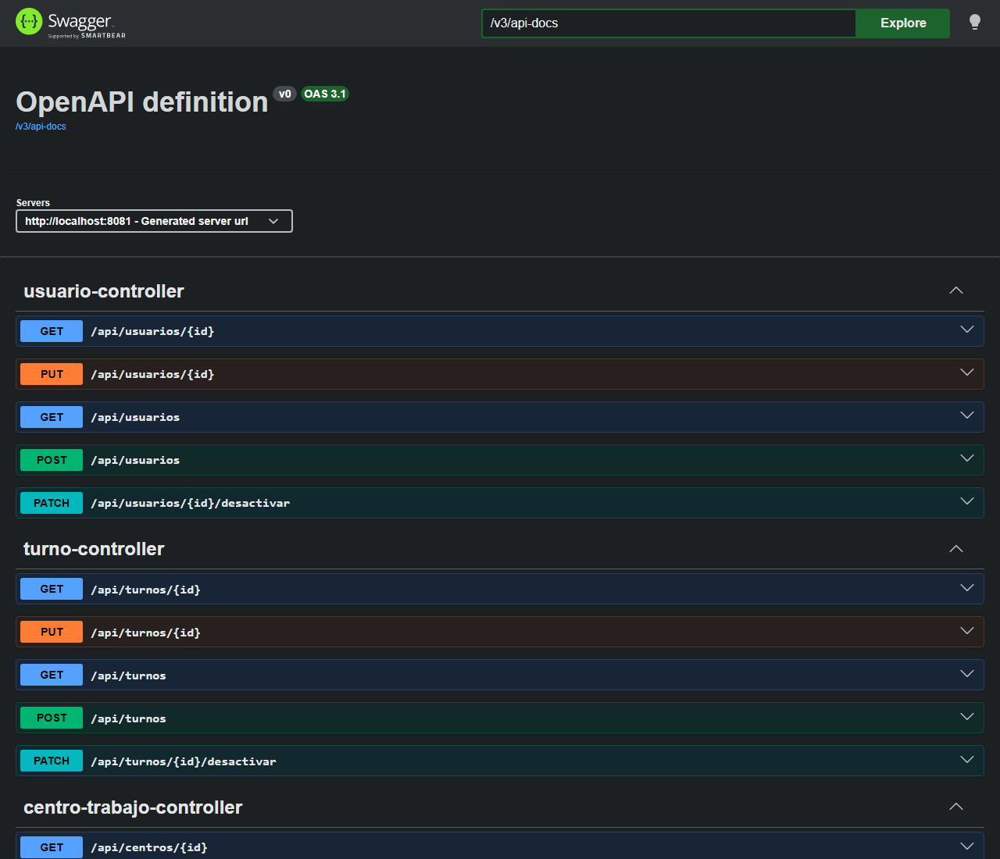

# App Fichaje

Aplicación de control horario para empresas. Los empleados fichan desde el móvil y el administrador gestiona usuarios, turnos y centros de trabajo desde una aplicación de escritorio. Las dos aplicaciones se conectan a la misma API REST, que es la que guarda los datos y aplica las reglas.

Es un proyecto personal que estoy haciendo por fases. Por ahora está terminada la API (v0.1.0), las siguientes fases son la aplicación de escritorio y la app Android.



## Funcionalidades

- CRUD de usuarios, turnos, centros de trabajo y asignaciones de turno.
- Fichaje con un solo botón. La API mira el último fichaje del usuario y decide si es entrada o salida.
- Para fichar el usuario tiene que estar activo, tener un centro de trabajo, estar dentro del radio del centro y tener un turno asignado ese día.
- No se puede fichar la entrada antes de tiempo. Si llegas tarde o sales antes o después de tu hora, el fichaje se guarda con una incidencia.
- Si un día no fichas la salida, cuando vuelves a fichar otro día la entrada que quedó abierta se marca como incidencia.
- Los usuarios y los turnos no se borran, se desactivan, porque hay que guardar el registro de jornada.
- No se puede desactivar ni quitar el rol al último administrador activo.
- Las contraseñas se guardan cifradas con BCrypt.
- Los errores se devuelven en formato ProblemDetail.

## Tecnologías

- Java 21
- Spring Boot 4.1 (Web, Data JPA, Validation)
- MySQL / MariaDB
- Lombok
- Swagger (springdoc-openapi)
- JUnit 5 y Mockito

Para el escritorio usaré JavaFX y para el móvil Android con Java.

## Estructura del proyecto

```
app-fichaje/
├── backend/    API REST
├── desktop/    aplicación de escritorio (pendiente)
├── android/    app móvil (pendiente)
└── docs/
```

## Cómo ejecutarlo

Hace falta tener JDK 21 y MySQL o MariaDB en el puerto 3306. Yo lo uso con XAMPP.

```
git clone https://github.com/PoloBernardosCarlos/app-fichaje.git
cd app-fichaje\backend
mvnw spring-boot:run
```

Los comandos son para el cmd de Windows, en Linux o Mac sería `./mvnw spring-boot:run`.

La base de datos `fichaje_db` se crea sola al arrancar con el usuario `root`. Si tu `root` tiene contraseña, antes de arrancar ejecuta `set DB_PASSWORD=tu_contraseña` en la misma ventana.

La API arranca en http://localhost:8081 y la documentación de Swagger está en http://localhost:8081/swagger-ui.html

## Probar un fichaje

Antes de fichar hay que crear un centro, un usuario con ese centro, un turno y asignarle el turno al usuario para el día de hoy. Los ids de los ejemplos son los de una base de datos vacía.

1. Crear el centro de trabajo con `POST /api/centros` (el radio va de 1 a 5000 metros):

```json
{ "nombre": "Oficina Madrid", "latitud": 40.4168, "longitud": -3.7038, "radioMetros": 200 }
```

2. Crear el usuario con `POST /api/usuarios` (el rol puede ser `ADMIN` o `EMPLEADO`):

```json
{
  "nombre": "Ana",
  "apellidos": "García López",
  "dni": "12345678Z",
  "email": "ana@ejemplo.com",
  "password": "contraseña1",
  "rol": "EMPLEADO",
  "centroTrabajo_id": 1
}
```

3. Crear el turno con `POST /api/turnos`. Para probarlo pon una hora de inicio cercana a la hora a la que vas a fichar, si no la entrada se rechaza por ser antes de tiempo:

```json
{ "nombre": "Mañana", "horaInicio": "09:00", "horaFin": "17:00", "margenMinutos": 15 }
```

4. Asignar el turno al usuario con `POST /api/asignaciones`. En `fecha` pon la fecha de hoy en formato `AAAA-MM-DD`:

```json
{ "id_usuario": 1, "id_turno": 1, "fecha": "fecha de hoy" }
```

5. Fichar con `POST /api/fichajes/nueva-ficha`:

```json
{ "usuarioId": 1, "latitud": 40.4168, "longitud": -3.7038 }
```

La primera vez se registra una entrada y la siguiente una salida.

Las rutas base son `/api/usuarios`, `/api/turnos`, `/api/centros`, `/api/asignaciones` y `/api/fichajes`. El resto de endpoints (listados, filtros por fechas, desactivar...) se pueden ver en Swagger.

## Tests

```
mvnw test
```

De momento están hechos los tests del módulo de fichajes:

- `ReglasFichajeTest`: 19 tests con JUnit de las reglas de fichaje (centro, usuario activo, radio, tipo de fichaje y horario del turno).
- `FichajeServicioImplTest`: 15 tests con Mockito del servicio de fichajes.

El test `contextLoads` arranca la aplicación, así que necesita MySQL encendido.

## Decisiones

Todo pasa por la API. El móvil no se puede conectar directamente a la base de datos, así que las dos aplicaciones van contra la API y las reglas están en un solo sitio.

El empleado no elige si ficha entrada o salida, lo calcula la API con el último fichaje. Así no se puede equivocar de botón.

Las reglas del fichaje están en una clase aparte, `ReglasFichaje`. El método `fichar` se estaba haciendo muy largo y lo separé, así el servicio solo coordina y las reglas se pueden probar por separado.

No hay turnos de noche, un turno empieza y acaba el mismo día. Lo dejé así para que las reglas del horario fueran más sencillas.

Para saber si el usuario está cerca del centro paso el radio de metros a grados y compruebo si la ubicación cae dentro de un cuadrado alrededor del centro. Es más sencillo que calcular la distancia real con la fórmula de Haversine, que queda pendiente.

## Pendiente

- Todavía no hay login, cualquiera puede llamar a la API. La seguridad (JWT y roles) es la siguiente fase.
- No se valida que la hora de fin del turno sea posterior a la de inicio.
- Como la zona para fichar es un cuadrado y no un círculo, en las esquinas se puede fichar algo más lejos del radio, y de este a oeste el margen sale más ancho (en Madrid alrededor de un 30%).
- Si se ficha dos veces en el mismo segundo el tipo puede salir mal, porque la fecha se guarda sin fracciones de segundo y la consulta del último fichaje no desempata. Lo revisaré cuando haga la app Android.
- Un JSON mal formado o una ruta que no existe devuelven 500 en vez de 400 o 404, y el 400 de validación no dice qué campo ha fallado.
- Los listados de fichajes se filtran en Java y no en la consulta. Con muchos fichajes habrá que pasarlo al repositorio y paginar.

## Hoja de ruta

- [x] v0.1.0: API REST
- [ ] v0.2.0: aplicación de escritorio
- [ ] v0.3.0: seguridad (login, JWT y roles)
- [ ] v0.4.0: app Android (fichar con huella y ubicación)
- [ ] v1.0.0: informes, horas extra e integración continua

## Autor

Carlos Polo Bernardos

[LinkedIn](https://www.linkedin.com/in/carlos-polo-bernardos)

## Licencia

MIT, ver [LICENSE](LICENSE).
